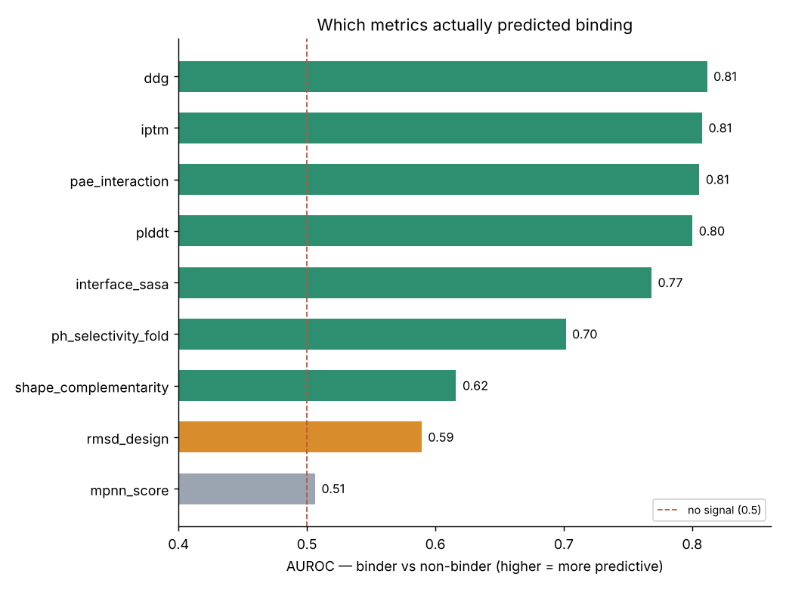
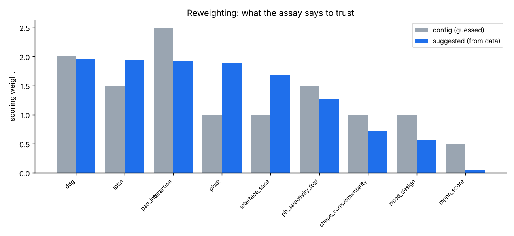

# Calibration report — EGFR

- Designs matched to assay results: **600**
- Measured binders: **177** (30%)

## Per-metric discrimination

| metric | AUROC | discrimination | Spearman vs pKd | weight → suggested |
|--------|-------|----------------|-----------------|--------------------|
| ddg | 0.81 | 0.62 | 0.54 | 2.00 → **1.96** |
| iptm | 0.81 | 0.62 | 0.79 | 1.50 → **1.94** |
| pae_interaction | 0.81 | 0.61 | 0.79 | 2.50 → **1.92** |
| plddt | 0.80 | 0.60 | 0.63 | 1.00 → **1.89** |
| interface_sasa | 0.77 | 0.54 | 0.56 | 1.00 → **1.69** |
| ph_selectivity_fold | 0.70 | 0.40 | 0.25 | 1.50 → **1.27** |
| shape_complementarity | 0.62 | 0.23 | 0.21 | 1.00 → **0.73** |
| rmsd_design | 0.59 | 0.18 | 0.12 | 1.00 → **0.56** |
| mpnn_score | 0.51 | 0.01 | 0.17 | 0.50 → **0.04** |

## Suggested config update

```yaml
# suggested scoring weights from calibration
# (paste each into the matching metric in the target YAML)
ddg: 1.96   # was 2.00, AUROC 0.81
iptm: 1.94   # was 1.50, AUROC 0.81
pae_interaction: 1.92   # was 2.50, AUROC 0.81
plddt: 1.89   # was 1.00, AUROC 0.80
interface_sasa: 1.69   # was 1.00, AUROC 0.77
ph_selectivity_fold: 1.27   # was 1.50, AUROC 0.70
shape_complementarity: 0.73   # was 1.00, AUROC 0.62
rmsd_design: 0.56   # was 1.00, AUROC 0.59
mpnn_score: 0.04   # was 0.50, AUROC 0.51
```

## Figures




