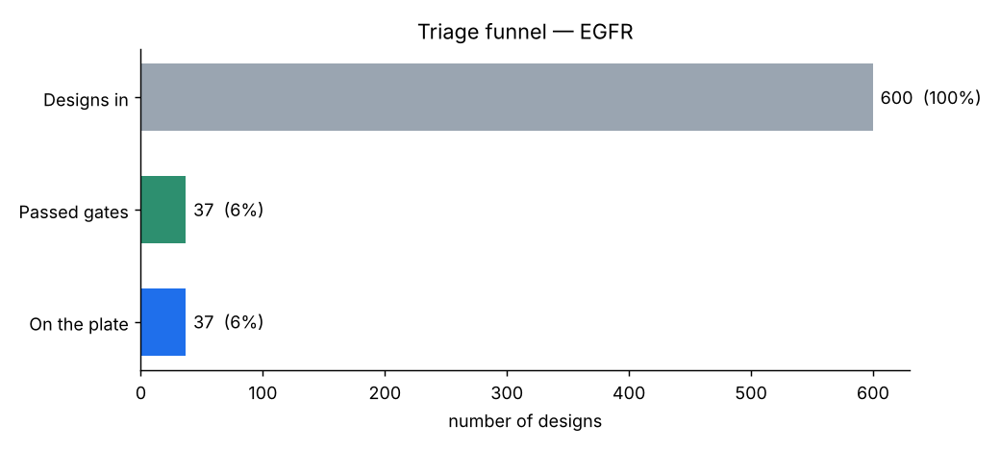
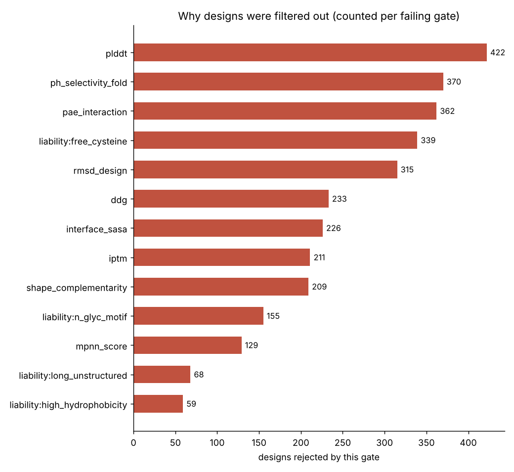
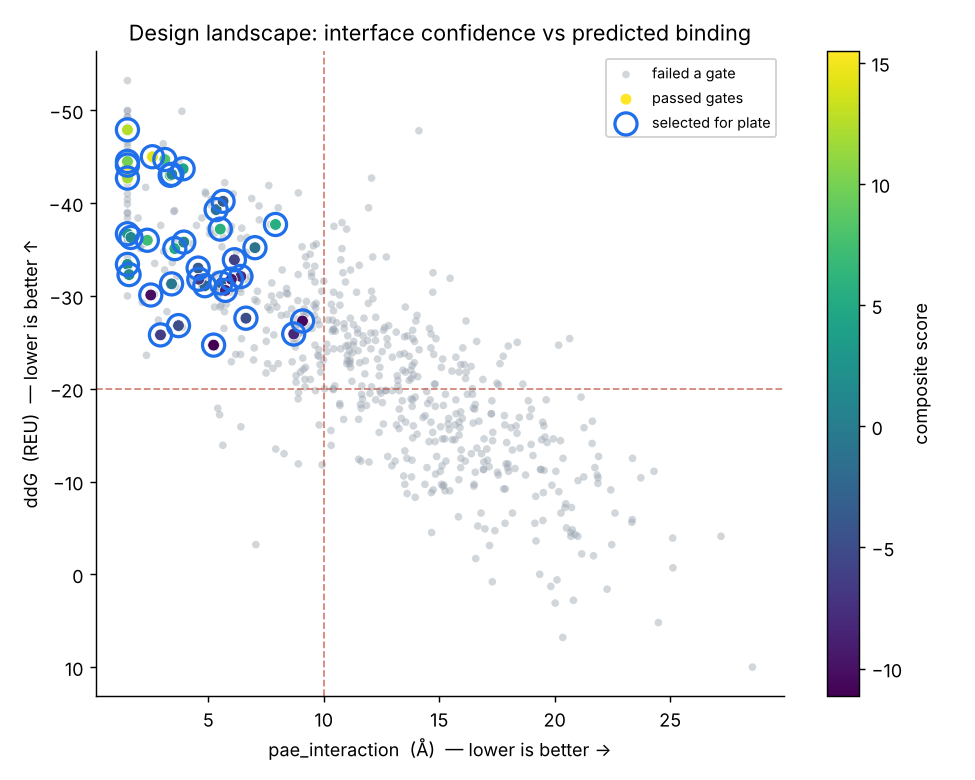
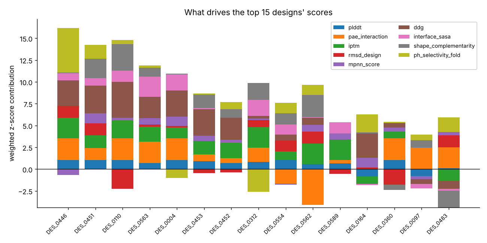

# Binder triage report — EGFR (Epidermal Growth Factor Receptor)

- **UniProt**: P00533
- **Conditional challenge**: pH-conditional binding - engage tumour (acidic), spare healthy tissue (on pH 6.5, off pH 7.4)
- **Reference binder**: Cetuximab (scFv format) (Kd ≈ 9.94 nM)

## Funnel

- Designs in: **600**
- Passed all hard gates: **37** (6%)
- Distinct sequence clusters among survivors: **31**
- Selected for the 96-well plate: **37**

## Rejection breakdown

| gate | designs dropped |
|------|-----------------|
| plddt | 422 |
| ph_selectivity_fold | 370 |
| pae_interaction | 362 |
| liability:free_cysteine | 339 |
| rmsd_design | 315 |
| ddg | 233 |
| interface_sasa | 226 |
| iptm | 211 |
| shape_complementarity | 209 |
| liability:n_glyc_motif | 155 |
| mpnn_score | 129 |
| liability:long_unstructured | 68 |
| liability:high_hydrophobicity | 59 |

## Top 15 ranked designs

| rank | design_id | score | method | ddg | pae_int | plddt | iptm |
|------|-----------|-------|--------|-----|---------|-------|------|
| 1 | DES_0446 | 15.47 | RFdiffusion+ProteinMPNN | -44.1 | 1.5 | 98 | 0.97 |
| 2 | DES_0451 | 14.23 | BindCraft | -45.0 | 2.6 | 98 | 0.90 |
| 3 | DES_0110 | 12.54 | RFdiffusion+ProteinMPNN | -47.9 | 1.5 | 98 | 0.95 |
| 4 | DES_0563 | 11.89 | RFdiffusion+ProteinMPNN | -42.7 | 1.5 | 95 | 0.92 |
| 5 | DES_0004 | 9.94 | BindCraft | -44.5 | 1.5 | 98 | 0.89 |
| 6 | DES_0453 | 8.23 | Cetuximab-graft (optimised) | -44.7 | 3.1 | 97 | 0.91 |
| 7 | DES_0452 | 7.31 | BindCraft | -43.0 | 3.4 | 95 | 0.93 |
| 8 | DES_0312 | 7.28 | BindCraft | -36.0 | 2.4 | 96 | 0.97 |
| 9 | DES_0554 | 5.82 | Cetuximab-graft (optimised) | -37.2 | 5.5 | 98 | 0.87 |
| 10 | DES_0562 | 5.55 | BindCraft | -37.7 | 7.9 | 94 | 0.97 |
| 11 | DES_0589 | 4.85 | Cetuximab-graft (optimised) | -35.1 | 3.5 | 95 | 0.97 |
| 12 | DES_0164 | 4.45 | BindCraft | -43.7 | 3.9 | 82 | 0.73 |
| 13 | DES_0360 | 3.03 | RFdiffusion+ProteinMPNN | -36.7 | 1.5 | 98 | 0.85 |
| 14 | DES_0097 | 1.76 | RFdiffusion+ProteinMPNN | -33.4 | 1.5 | 82 | 0.80 |
| 15 | DES_0483 | 1.53 | RFdiffusion+ProteinMPNN | -32.3 | 1.6 | 90 | 0.69 |

## Figures

